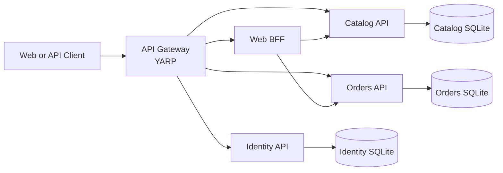

# Architecture

## Context

The API Gateway is the only intended public entry point. It routes authentication requests to Identity, catalog and order requests to their owning services, and web dashboard requests to the Web BFF.

## Responsibilities

| Component | Responsibility | Persistence |
|---|---|---|
| API Gateway | External routing and JWT validation | None |
| Identity API | Registration, password hashing, login, JWT issuance | Identity SQLite |
| Catalog API | Product listing and lookup | Catalog SQLite |
| Orders API | Create and read customer-owned orders | Orders SQLite |
| Web BFF | Aggregate catalog and customer orders for the web client | None |

## Request flows

### Authentication

1. Client sends registration or login to the Gateway.
2. Gateway routes the public authentication path to Identity.
3. Identity validates input, applies per-observed-IP rate limiting, and stores password hashes.
4. On successful login, Identity issues a 30-minute JWT.
5. The client sends the bearer token on protected requests.

### Dashboard aggregation

1. Client calls `GET /api/web/dashboard` with its bearer token.
2. Gateway validates the JWT and forwards the request to Web BFF.
3. BFF forwards the bearer token to Catalog and Orders concurrently.
4. BFF returns the combined products and customer-owned orders.

### Order ownership

Orders are queried by both order identifier and authenticated customer identity. A request for another customer's order returns 404 rather than exposing whether that order exists.

## Boundaries and trade-offs

- Each service owns its data and schema; databases are not shared.
- SQLite keeps local setup simple. It is not a substitute for a managed multi-instance production database.
- The current JWT signing key is shared across services and must be injected consistently. Coordinated key rotation is not implemented.
- The current BFF uses bounded HTTP timeouts but does not yet implement retries or circuit breakers.
- Readiness checks verify downstream dependencies; liveness checks only indicate that the process responds.
